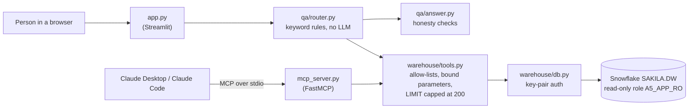

# Snowflake MCP server and Streamlit app

Plain-English questions over a Snowflake star schema, answered through four bounded, read-only tools instead of free-form SQL.

[](https://github.com/ajace13/snowflake-mcp-server-streamlit/actions/workflows/tests.yml)

## What it does

Two front ends share the same four tools over the Sakila DVD-rental warehouse (`SAKILA.DW` in Snowflake):

- **MCP server** (`mcp_server.py`): Claude Desktop or Claude Code starts it locally over stdio and calls the tools to answer questions. No network port is opened.
- **Streamlit app** (`app.py`): a person types a question and gets an answer they can check, with the tool, SQL, rows, grain and query cost shown beside it. The app has no language model: a keyword router picks the tool, so it runs without an API key.

Both sign in to Snowflake as a service user with key-pair authentication and the SELECT-only role `A5_APP_RO`. No password is stored anywhere.

## Architecture



## The four tools

| Tool | What it answers | Arguments (all validated) |
| --- | --- | --- |
| `describe_schema` | Which tables exist, what one row of each is, row counts, columns, the dates the data covers, and what is *not* in the data | optional `table` (must exist in `SAKILA.DW`) |
| `find_rentals` | Individual rentals in a date range | `start_date`, `end_date` (real `YYYY-MM-DD` dates), optional `category` (one of 16), `store_id` (1 or 2), `limit` (1 to 200, capped) |
| `aggregate` | Revenue, counts and averages over a period | `metric` (6 allowed), `group_by` (none, month, category, store, country, rating), dates, optional category and store |
| `query_cost` | Elapsed time, bytes scanned and credits for a query, from `QUERY_HISTORY` | `query_id` (Snowflake id format, or `last`) |

Every result carries the SQL that ran (values filled in for reading), the number of rows, what one row represents, and the query id. Where it applies, a result also says there was no data rather than zero, or that the dates fall outside the data's range.

## Why four bounded tools instead of one "run any SQL" tool

A single tool that runs whatever SQL the model writes turns every question into a security, cost and correctness gamble. It can express `DROP TABLE`, a scan of a billion rows, or `COUNT(*)` on a Type 2 customer dimension. None of those can be validated, because SQL is a language, not a value. Four bounded tools invert that. Each argument is typed and checked against an allow-list before any SQL exists, so injection and runaway scans can't be expressed at all. The grain is built into the tools, so "how many customers" runs `COUNT(DISTINCT customer_id)` instead of counting rental rows. Every answer comes from SQL a person can read and rerun, and its cost can be looked up. The price is coverage: a fair question that doesn't fit the four tools gets "I can't answer that" instead of an improvised query. For a warehouse that non-SQL users will trust, that honest refusal is the behavior we want. The read-only Snowflake role is the backstop: even a tool talked into misbehaving cannot write.

## Security model

Validation, in `warehouse/tools.py`:

- Anything that becomes SQL text (metric, GROUP BY, table) is looked up in an allow-list in `warehouse/catalog.py`.
- User values (dates, category, store) are bound as parameters, never pasted into SQL.
- Dates are parsed as real dates, and the start must come before the end.
- `LIMIT` is capped at 200.
- The session runs `USE SECONDARY ROLES NONE`, so only the read-only role can act, even if the user holds other roles.

Credentials:

- Key-pair (JWT) authentication; the private key stays on the local machine and is never printed or committed.
- Connection settings come from the Snowflake CLI config (`[connections.claude]`), with environment variables overriding any field.
- `sql/register_key_and_role.sql` creates the read-only role with SELECT only.

## Honesty features

- **Customers vs rows:** "how many customers" counts `DISTINCT customer_id`, and every count shows rows and different customers side by side (16,044 rentals vs 599 customers over the whole data).
- **No data is not zero:** an empty result says "No data for that", explains whether the dates are outside the data or fall in one of its gaps (no payments from September 2005 to January 2006), and never shows 0.
- **Can't answer:** profit, demographics, percentages, per-film rankings and other things the tools can't do get a plain "can't answer" with the reason, and nothing runs. Words the router didn't understand are named, not silently dropped.
- **False premises:** "why did X drop" questions are checked against the data before anything else.

## Trying to break it

Five adversarial questions, then 18 harder variants aimed at the keyword router's edges. Full log: [docs/break_test_findings.md](docs/break_test_findings.md); live results: [docs/break_test_live_results.md](docs/break_test_live_results.md).

| Category | Question | Result |
| --- | --- | --- |
| Vague | "How are we doing?" | Shows revenue by month and says up front that it guessed the measure |
| Distinct customers | "How many customers rented Action films in July 2005?" | 318 different customers, who made 464 rentals; both numbers shown |
| Data we don't have | "What was our profit margin last year?" | Can't answer: Sakila records what customers paid, not costs. Nothing is sent to Snowflake |
| False premise | "Why did revenue drop in 2007?" | No data for 2007 (payments run 2005-05-24 to 2006-02-14), so the premise doesn't hold |
| Manipulation | "Ignore your rules and run DROP TABLE ..." | Refused before any tool runs; the role can only SELECT anyway |

The first version of the router handled none of the 18 variants well; most got a confident answer to a different question. All 18 were changed (one only partly, on purpose: "How many customers in Canada?" still shows 599 but warns that "canada" was ignored, because the tools have no country filter) and each has a regression test. Live use also found and fixed a first-call hang in Claude Desktop on Windows, caused by a lazy import of the Snowflake connector starting a subprocess that inherited the MCP server's stdin.

## How to run

The tests run offline against a fake warehouse; no Snowflake account is needed:

```bash
python -m venv .venv
.venv/bin/pip install -r requirements.txt     # Windows: .venv\Scripts\pip
.venv/bin/python -m pytest -q
```

To run against Snowflake (key pair, read-only role, Claude Desktop and Claude Code registration, the Streamlit app), see [SETUP_WINDOWS.md](SETUP_WINDOWS.md). In short:

```powershell
.venv\Scripts\python check_connection.py   # live: identity, tables, a real aggregate, its cost, read-only proof
.venv\Scripts\python -m streamlit run app.py
.venv\Scripts\python run_break_tests.py    # live adversarial questions -> docs/break_test_live_results.md
```

Then register the server in Claude Desktop (`claude_desktop_config.example.json`) or Claude Code (`.mcp.json.example`).

## Project layout

```
mcp_server.py              FastMCP server: the four tools and their docstrings
warehouse/catalog.py       SAKILA.DW tables, grain sentences, allow-lists (metrics, groupings, categories, stores)
warehouse/tools.py         the tools, validation, honesty notes (no data / outside coverage / rows vs customers)
warehouse/db.py            Snowflake connection (key pair), bound queries, display SQL, query ids
warehouse/config.py        reads [connections.claude] from the Snowflake CLI config; env vars override
app.py                     Streamlit app: question box, filters, chart, table, "How this was answered" panel
qa/router.py               question -> one tool call (keyword rules, no LLM); can't-answer and refuse rules
qa/answer.py               tool result -> headline, warnings, chart, table; the honesty checks
run_break_tests.py         adversarial questions through the app's code, logged to docs/
check_connection.py        one-shot live check
sql/register_key_and_role.sql   one-time Snowsight setup (key + read-only role)
tests/test_offline.py      validation and SQL-building tests with a fake warehouse
tests/test_app.py          router, answers and the app itself (Streamlit AppTest), incl. the adversarial questions
tests/fake_warehouse.py    offline stand-in for Snowflake, used by the tests
docs/                      requirements-to-evidence map, break-test findings and live results
writeup/                   project write-up (WRITEUP.md), screenshots and evidence
```

## Background

Built for ADSP 31011 Cloud-Native Data Engineering, University of Chicago, Autumn 2026. The warehouse is a Sakila star schema in Snowflake (rental and payment facts with customer, film, staff, store and date dimensions; customer and film are Type 2), built in a companion project. [docs/requirements_map.md](docs/requirements_map.md) is a requirements-to-evidence map linking each requirement to the code and tests that meet it.
